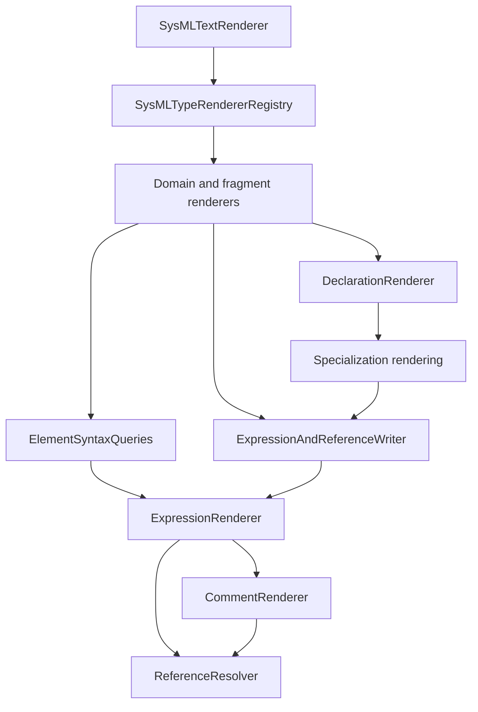

# syson-sysml-serializer

Serializes OMG SysMLv2 model objects to SysMLv2 text or standalone highlighted HTML.

`SysMLSerializer` accepts model elements or parser results. Keep the parser result
when available: its dangling links preserve references that are not yet resolved.
`SerializationOptions` selects round-trip or normalized output and formatting.

The convenience methods cover the common cases. Everything else goes through a
`SerializationRequest`, which names each optional collaborator:

```java
String text = new SysMLSerializer().serialize(SerializationRequest.forElement(root)
        .withOptions(SerializationOptions.defaults())
        .withDanglingReferences(danglingReferences)      // parser spellings of unresolved references
        .withContextualNames(referenceNameResolver)      // caller-defined shortest visible names
        .withReferencePaths(referencePathResolver));     // linker-confirmed alias paths
String html = new SysMLSerializer().serializeToHtml(SerializationRequest.forParseResult(parseResult)
        .withHtmlLinks(linkResolver));                   // navigable references, HTML only
```

The main package contains the serialization API (`SysMLSerializer`, `SerializationRequest`,
`SerializationOptions`), `SerializationContext`, and `ElementDispatch`. Feature packages follow the rendering pipeline; names below
are relative to `org.eclipse.syson.sysml.serializer`:

| Package | Responsibility |
| --- | --- |
| `rendering` | Session composition and ordered element dispatch |
| `rendering.declarations` | Shared declaration grammar, generic definitions/usages, metadata and bodies |
| `rendering.actions` | Actions, state subactions, successions and transitions |
| `rendering.connections` | Connectors, interfaces, flows and payloads |
| `rendering.relationships` | Body relationship dispatch, memberships, imports and requirements |
| `rendering.fragments` | Standalone parser-rule fragments |
| `expression` | Expression forms, precedence and reference occurrences |
| `specialization` | Specialization facts, clause planning and emission |
| `references` | Syntax-specific reference names, targets and paths |
| `syntax` | Source-entry predicates, comments and declaration keyword mappings |
| `tokens` | Shared SysML grammar tokens, with no serializer dependencies |
| `model` | EMF navigation and decisions about explicit bodies, generated elements and promoted metadata |
| `names` | Contextual name rendering and identifier escaping |
| `output` | Text formatting, HTML document assembly and expression/reference emission with traces |

Collaborations between packages use public types and methods. Implementation-only
collaborators stay package-private; helpers used by one class stay private.

Use qualified `SysMLTokens` constants for grammar keywords, operators, delimiters,
and literal whitespace. Keep regexes, escaping replacements, and semantic lookup
keys private to their owning logic. Literal spaces and line feeds retain their
exact meaning; output formatting still belongs to `TextOutput`.

## Rendering pipeline

`SysMLSerializer` creates a fresh rendering context for each call.
`SysMLTextRenderer.serializeElement` scopes names and output traces around each
recursive visit. `SysMLTypeRendererRegistry` tries its ordered rules: parser
fragments precede specialized model syntax, then generic declarations. Its
per-metaclass cache narrows candidate rules; instance predicates still decide
which renderer applies.

Domain renderers receive concrete constructor dependencies. `DeclarationRenderer`
emits the shared grammar parts, including membership visibility, while `ElementSyntaxQueries` decides whether
model contents have explicit syntax. `ElementDispatch` is the narrow callback
for recursive element/relationship traversal and forced generic declarations;
it exposes no rendering services. `SerializerArchitectureTest` checks that imports
between rendering implementation packages are acyclic. Shared API, naming,
model-navigation, and output-support types are outside that graph. The rendering
components `SerializationContext`, `ElementDispatch`, `ElementSyntaxQueries`, and
`ExpressionAndReferenceWriter` remain included even though they share packages
with API and support types.



All rendering uses the same per-call `SerializationContext`. Recursive calls
return through `ElementDispatch` to the session so name scopes and element traces
stay consistent for both text and HTML output.

| Concern | Start here |
| --- | --- |
| Expressions and parentheses | `ExpressionRenderer`, `OperatorExpressionRenderer`, `OperatorPrecedence`; package-private `AtomicTokenScanner` steps text scans over string literals, quoted names and comments |
| Specialization clauses | `SpecializationFactsCollector` collects the targets and multiplicity in source order; `SpecializationClausePlanner` groups them into clauses with their source spelling and places `ordered`/`nonunique`; `SpecializationRenderer` and `SpecializationClauseRenderer` emit them; `model.SpecializationTargetNames` supplies the target names of typing, subsetting, redefinition, reference and cross subsetting |
| Reference occurrences in expression text | `ExpressionReferenceCollector` maps spellings to model targets; package-private `ReferenceTextScanner` owns text scanning and substitution, without model traversal |
| Names and reference paths | `names.NameRenderer` handles contextual names; `references.ReferenceResolver` selects syntax-specific targets and paths; `ExpressionAndReferenceWriter` records references |
| Unresolved references | `model.DanglingReferenceIndex` retains parser spellings; `model.ReferenceTargets` chooses between them and model targets for one reference; `model.NestedTargetSearch` finds them in owned subtrees (feature chains, assignment targets, shorthand ends) |
| EMF navigation | `model.ModelNavigation` follows containment only; `model.ReferenceTargets` names references and proxies through stored model data and caller hooks; `SafeEmfAccess.unresolvedValues` reads references without resolving proxies |
| Keywords and modifiers from model attributes | `model.ModelFlags` (visibility, `abstract`, `variation`, `ordered`, direction, portion kind, ...) |
| Source choices recorded by the parser | `model.ParserAdapterQueries` (text markers, comments, raw comment bodies, literal spellings) |
| Multiplicities | `model.MultiplicityText` |
| Output | `output.StringTextOutput` owns spacing and indentation; `output.HtmlTextOutput` uses the same buffer and adds traces consumed by `SysMLHtmlDocumentRenderer` |

ROUND_TRIP uses parser adapters to retain syntax choices. Plain text and HTML
share syntax rendering and buffer formatting; source whitespace is not replayed.
NORMALIZED derives declarations from the
model; the semantic corpus also exercises it after removing text adapters.
Do not treat adapters as disposable: some carry choices needed by both modes.

`SerializationContext` holds the run's dependencies; `model.SerializerModelQueries` wires the model
queries above once per run, and each renderer keeps only the ones it uses. Mutable buffers,
name scopes, dispatch caches, expression-reference caches, and the generated-element
cache in `ElementSyntaxQueries` belong to that run; they are not shared across
calls on `SysMLSerializer`.

From the repository root, build the whole reactor and run tests, Checkstyle,
and PMD with:

```sh
mvn -s ~/.m2/settings.xml -B -ntp clean verify
```

From the repository root, inspect fixture coverage in
`backend/application/syson-sysml-serializer/target/site/jacoco/index.html` after:

```sh
mvn -s ~/.m2/settings.xml -B -ntp -Pfixture-coverage verify
```

`SysMLSerializationPerformanceIT` is excluded from the regular test naming convention.
Run its default fixtures explicitly, keeping the same warmups and iterations
when comparing revisions:

```sh
mvn -s ~/.m2/settings.xml -B -ntp \
  -Dtest=SysMLSerializationPerformanceIT -Dsurefire.failIfNoSpecifiedTests=false \
  -Dsyson.serializer.performance.warmups=1 \
  -Dsyson.serializer.performance.iterations=3 test
```

## Test organization

Test classes are grouped by the behavior they specify. Each test method documents
its expected result using explicit "must" or "must not" statements.

| Test class | Expected behavior |
| --- | --- |
| `SysMLTextRoundTripTest` | Preserve source characters other than whitespace in `ROUND_TRIP` mode. |
| `SysMLModelRoundTripTest` | Preserve canonical model XMI after removing text adapters, serializing, and reparsing. |
| `SerializerFixtureSelectionTest` | Detect corpus selection changes and fail on unexpected discovery errors. |
| `SysMLSerializerApiTest` | Return empty output for the supported null inputs and serialize incomplete models without throwing. |
| `SysMLSyntaxPreservationTest` | Preserve declarations, comments, actions, transitions, and invocation syntax. |
| `ExpressionParenthesesSerializationTest` | Preserve expression grouping without unnecessary parentheses. |
| `QuotedNameSerializationTest` | Preserve separators inside quoted qualified-name segments. |
| `TextBodySerializationTest` | Preserve comment bodies and export edited documentation and representations. |
| `CrossResourceReferenceSerializationTest` | Resolve imported names, typing, aliases, and feature chains across Resources. |
| `DependencyReferenceSerializationTest` | Preserve every endpoint of partially resolved dependencies. |
| `EditedReferenceTargetSerializationTest` | Name the current target of linked imports, aliases, redefinitions, direct references, transition sources and metadata `about` targets after renaming or retargeting. |
| `ProxyAndResolvedReferenceSerializationTest` | Bind visible references to their targets and reflect resolution and renaming. |
| `EditedModelStateSerializationTest` | Write the closest parseable text for edited model states the grammar cannot express, and never text that reparses into an unrelated model. |
| `ImpliedRelationshipSerializationTest` | Omit implied relationships and the declarations they own. |
| `ExpressionReferenceCollectorTest` | Match reference occurrences and bind their segments to the correct targets. |
| `AtomicTokenScannerTest` | Keep grouping and reference replacement consistent with lexer comment boundaries. |
| `ReferenceNameMatcherTest` | Compare names independently of identifier quotes while preserving qualification differences. |
| `DanglingReferenceIndexTest` | Answer unresolved-reference queries without failing on incomplete parser links. |
| `NameEscaperTest` | Quote invalid or reserved name segments without damaging compound names. |
| `NameRendererTest` | Render effective and contextual names, including incomplete and large model contexts. |
| `StringTextOutputTest` | Respect text formatting without evaluating HTML reference metadata. |
| `HtmlTextOutputTest` | Highlight and escape output, expose target metadata, and create valid navigation anchors. |
| `SysMLHtmlModelTraceabilityTest` | Associate serialized HTML and qualified-name segments with the original EMF elements. |
| `SysMLGrammarCoverageTest` | Exercise grammar decision alternatives and non-whitespace lexer token types. |
| `SerializerArchitectureTest` | Keep the token vocabulary independent and rendering implementation package imports acyclic. |
| `SysMLSerializationPerformanceIT` | Measure parsing and serialization while checking repeatable output; no timing threshold. |

`SerializerRoundTripTestSupport` shares fixture providers and round-trip assertions;
it contains no JUnit tests. `ParserRuleFixtureDiscovery` discovers parser entry
points and resource folders. `SerializerHtmlFixtureGenerator` generates HTML for
manual inspection.

The integration with SysON textual document export is tracked in [#2661](https://github.com/eclipse-syson/syson/issues/2661).

## Test Corpus Strategy

Group standalone regression fixtures by language feature under
`src/test/resources/testcases`, for example `actions`, `expressions` or `references`.
Fixtures covering several features belong with their main purpose.
Keep imported corpora in their existing directories.

Parser fixture discovery fails on unexpected exceptions, I/O errors, or error
diagnostics. The selected parser fixtures are recorded in
`src/test/resources/parser-fixture-selection.tsv`. When that corpus changes,
review `target/parser-fixture-selection.tsv` before updating the recorded inventory.
The prefix-only fixtures listed, with reasons, in
`src/test/resources/partial-parser-rule-fixtures.tsv` retain their semantic checks
but omit exact-text comparison. Tests fail if an exclusion becomes obsolete or
another exact-text fixture stops consuming its entire input.

Serializer corpus tests should start from SysML source text and parse it with
the same parser entry point used by the parser tests. Do not use the parser
`*-model-expected.txt` XMI files as the primary serializer input: those files do
not contain every syntax choice carried by parser `ITextAdapter` instances, and
they do not preserve the parse result's dangling-link context. The reliable
semantic check is therefore:

1. parse the `.sysml` fixture,
2. serialize the resulting model,
3. parse the serialized text again with the same parser entry point,
4. compare canonical XMI for semantic equivalence.

Direct XMI-to-text tests are still useful for narrowly scoped normalized-output
cases, but they cannot prove exact parser/serializer coherence on their own.
