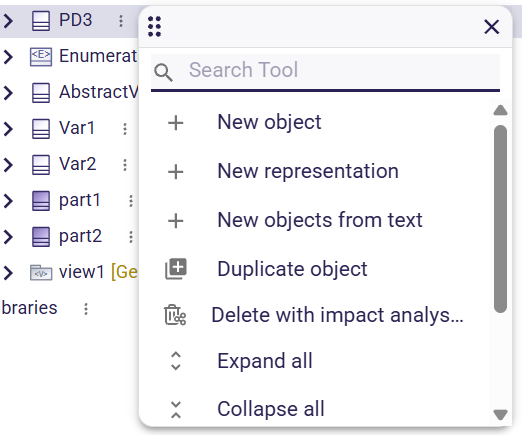
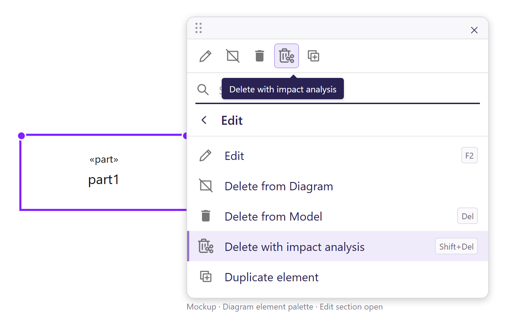

:author: Jérôme Gout <jerome.gout@obeosoft.com>
:date: 2026-11-27
:status: proposed
:consulted:
:informed:
:deciders:
:issue: https://github.com/eclipse-syson/syson/issues/2682, https://github.com/eclipse-syson/syson/issues/2683

= Delete with impact analysis

== Problem

Deleting a SysML element can also delete related elements or modify references elsewhere in the model.
Users cannot review these consequences before using the existing Delete tools.

== Key Result

Users can review the semantic impact of a deletion from the explorer or a diagram before confirming it.

=== Acceptance Criteria

* Add a separate *Delete with impact analysis* tool in the explorer and diagram element palettes.
Keep the existing Delete tools available.
* Show the elements that would be deleted or modified, including indirect effects on SysML relationships.
* Computing the report leaves the model unchanged.
Users can confirm the deletion or cancel without changing the model.
* In the explorer, place the tool after *Duplicate object*, as shown below.
* In diagram element palettes, provide both an entry in the *Edit* section and a shortcut action in the palette's top toolbar.

== Solution

The separate *Delete with impact analysis* tool is a transitional solution: the long-term goal is to replace Delete with impact-aware deletion, but https://github.com/eclipse-sirius/sirius-web/issues/7182[Sirius Web issue #7182] currently blocks the full implementation.
Keeping a separate tool also allows us to test and validate the impact analysis approach against the highly complex SysMLv2 metamodel before replacing Delete.

Reuse the Sirius Web impact analysis API and confirmation dialog with the existing SysON semantic deletion behavior.
Shortcut should be SHIFT+DEL keys.

=== Vision

The explorer palette contains the new action among the object tools.

For diagram elements, expose the same action in the *Edit* section and in the top shortcut toolbar.

=== Cutting backs

Accept separate positions for *Delete* and *Delete with impact analysis* in the explorer palette.
Sirius Web renders backend tools first, followed by frontend contributions, including Rename and Delete.
The current palette configuration cannot place the two Delete tools next to each other.
There is an issue regarding the fact that Delete tool is hard coded in the front end: https://github.com/eclipse-sirius/sirius-web/issues/7182

== Rabbit holes

Keep the preview consistent with the confirmed deletion, including indirect changes to SysML relationships.

== No-gos

* Replacing the existing Delete tools in this iteration.
* Redesigning the explorer palette or its ordering mechanism.
