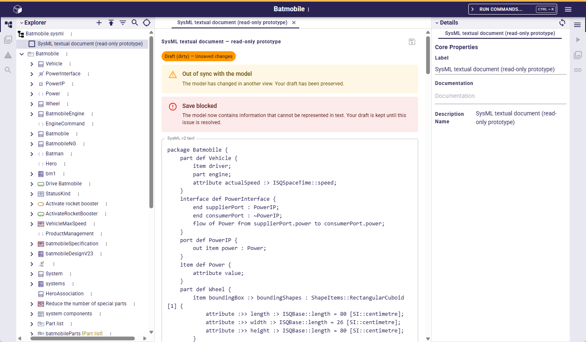

:author: Guillaume Coutable <guillaume.coutable@obeo.fr>
:date: 2026-11-09
:status: proposed
:consulted: Axel Richard <axel.richard@obeo.fr>, Mélanie Bats <melanie.bats@obeo.fr>, Alex Fournie <alex.fournie@obeosoft.com>
:informed: Axel Richard <axel.richard@obeo.fr>, Mélanie Bats <melanie.bats@obeo.fr>, Alex Fournie <alex.fournie@obeosoft.com>
:deciders: Axel Richard <axel.richard@obeo.fr>, Mélanie Bats <melanie.bats@obeo.fr>, Alex Fournie <alex.fournie@obeosoft.com>
:issue:

= (M) Experimental SysMLv2 Textual Editor

== Problem

SysON users cannot directly edit an existing model through its SysMLv2 textual notation alongside diagrams and the Details view.
Importing modified text may recreate elements, putting their identity and existing diagram layouts at risk.

On large models shared by several users, the model may change while a user is editing text.
Users need an integrated textual editor that reflects model changes, preserves pending edits, and reconciles them safely when saving.

== Key Result

Users can view and edit a SysMLv2 document through an integrated textual representation, while preserving model consistency, element identities, and existing diagram layouts.
Users can select, copy and paste text using familiar text-editing interactions and keyboard shortcuts.
Saving reconciles textual edits with model changes made through other views or by other users; rejected saves preserve the draft and leave the model unchanged.

=== Acceptance Criteria

* Users can create a central textual representation on a SysMLv2 element.
It displays the complete containing document.
* The editor displays line numbers and SysMLv2 syntax highlighting.
Users can select any portion of the text or all of it (Ctrl+A), copy selected text (Ctrl+C), and paste text when editing is enabled (Ctrl+V).
* A Copy button lets users copy the entire displayed text in a single action.
* While no draft exists, the text reflects model changes, including those made by other users.
Refreshes preserve the visual position of the element being read while it remains present.
* When serialization reports a blocking problem, the displayed text is read-only unless a draft already exists.
Reported serialization, syntax, conversion, reference resolution, comparison or application problems indicating errors, conflicts or potential information loss prevent saving.
Available diagnostics are displayed, any existing draft is preserved, and a rejected save leaves the model unchanged.
* Editing creates a visibly dirty draft.
Model updates do not overwrite it.
* Save temporarily makes the editor read-only and reconciles the draft with the current model through three-way comparison.
A successful save preserves existing element identities and diagram layouts, displays a success notification, clears the dirty state, and resumes automatic refresh.
* Closing the representation or switching to another representation with a pending draft requires confirmation before discarding it.
Cancelling keeps the representation and its draft open.
* While the textual editor has focus, Undo/Redo only affects textual edits within the current draft.
It never triggers global model undo/redo and does nothing when no local operation is available.
* Outside the textual editor, Undo/Redo follows the standard Sirius Web behavior.
Each successful textual save is recorded as a single undoable operation.

== Solution

The solution is delivered in two stages: a read-only textual representation, followed by textual editing with explicit saving.
Both stages are part of this iteration.

=== Read-only textual representation

Introduce a central textual representation that can be created on any SysMLv2 element.
It displays the complete document containing that element.

Start with a read-only text area, then integrate a text editor with syntax highlighting.
When the representation is created or reopened after being closed, the editor navigates to the element on which it was created.

The content refreshes automatically when the model changes, including changes made by other users.
Refreshes preserve the visual position of the element being read while it remains present.

=== Textual editing and explicit save

Allow users to edit the displayed text unless the serializer reports a problem preventing safe editing.
In that case, display the available text in read-only mode and show the diagnostic reported by the serializer.

The first modification creates a dirty draft and suspends automatic content refresh.
If a blocking serialization problem is reported while a draft exists, preserve the draft, allow further editing, show the diagnostic reported by the serializer, and block saving while the problem persists.

On Save, temporarily make the editor read-only and reconcile the draft with changes made to the model since the displayed text was generated, including those made by other users.
The common ancestor corresponds to that model state and remains unchanged while the draft exists.

If errors, conflicts, or information loss are detected, reject the save, display available diagnostics, and preserve the draft without changing the model.
On success, notify the user, clear the dirty state, and refresh the text from the resulting model.
Automatic refresh then resumes.

Require confirmation before discarding a draft when closing or switching representations.
This requires a Sirius Web enhancement allowing a representation to request confirmation before it is closed or replaced by another representation.

Provide a button to copy the entire displayed text.
If users cannot save a draft, they can copy it before discarding it, reopen the representation to load the current model, and use the copied text as a reference to manually reapply their changes.

While the editor has focus, Undo/Redo only affects textual edits within the current draft and does nothing when no local operation is available.
Outside the editor, standard Sirius Web behavior applies, with each successful save recorded as one undoable operation.

=== Breadboarding

Proof of concept of the textual editor as a representation.

=== Cutting backs

* Defer the action that navigates to the current workbench selection and the automatic highlighting of selected elements.
* Display available diagnostics as messages.
Highlighting the affected text and providing navigation to errors or conflicts can be deferred.
* Defer advanced language tooling such as completion, refactoring, or quick fixes.

== Rabbit holes

* Preserving the draft's original context.
Changes elsewhere in the model can affect the interpretation of a pending draft.
Establish how to preserve the context needed for reconciliation without retaining excessive data for large models and multiple users.
* Handling diagnostics across the editing workflow.
Verify that blocking diagnostics from serialization, parsing, conversion and reconciliation reach the editor and prevent saving without altering the model.
Avoid expanding this work into an exhaustive round-trip equivalence check or a general-purpose SysMLv2 validation engine.

== No-gos

* Selection-driven side editors or editing only an element and its descendants.
* Automatic saving while editing.
* Automatic integration of model changes into a pending draft.
* Draft recovery after closing the representation or restarting the application.
* Real-time co-editing of a shared text buffer, partial editing zones, user presence indicators, or locking parts of the document.
* Interactive conflict resolution.
* Language Server Protocol (LSP) integration.
